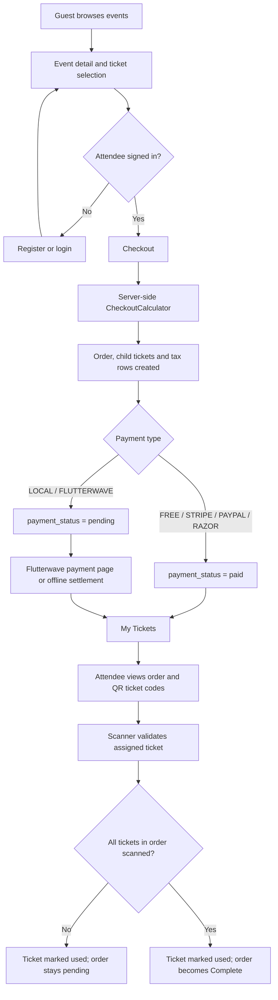
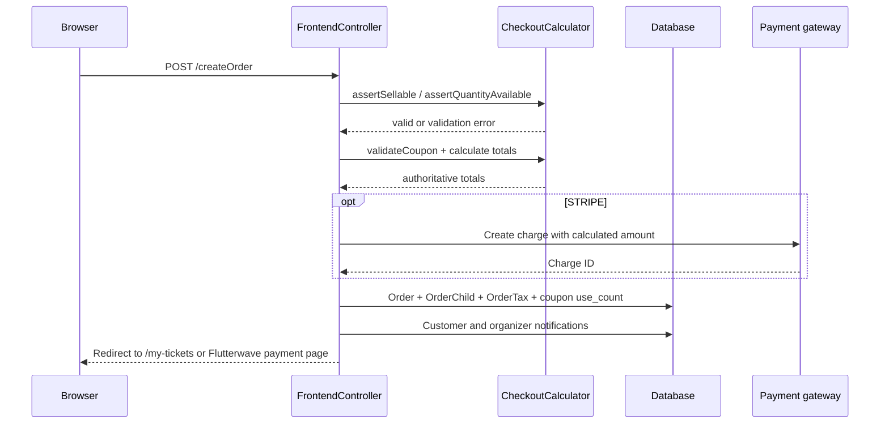

# User flow reference

This document describes the **current implementation** of the Laravel event/ticketing application after the Phase 6 and follow-up security/cleanup work. It is written from the routes, controllers, middleware and browser scripts in this repository, so it documents actual behaviour rather than intended behaviour.

It covers the public site, attendee accounts, checkout and payments, organizer and admin areas, the customer/organization/scanner APIs, and the license/installer flow at a high level. It does not change or bypass any existing logic.

## Contents

- [Actors and authentication domains](#actors-and-authentication-domains)
- [End-to-end overview](#end-to-end-overview)
- [Guest and public browsing](#guest-and-public-browsing)
- [Attendee registration and login](#attendee-registration-and-login)
- [Web checkout and order creation](#web-checkout-and-order-creation)
- [After purchase: tickets, orders, reviews and profile](#after-purchase-tickets-orders-reviews-and-profile)
- [Customer API flows](#customer-api-flows)
- [Organizer flows](#organizer-flows)
- [Admin and license flows](#admin-and-license-flows)
- [Scanner and PWA flows](#scanner-and-pwa-flows)
- [Shared checkout rules](#shared-checkout-rules)
- [Known legacy caveats](#known-legacy-caveats)
- [Manual verification checklist](#manual-verification-checklist)
- [Primary source files](#primary-source-files)

## Actors and authentication domains

The application has several distinct identity domains. They do not share one login session.

| Actor | Model | Web identity | API identity | Main entry points |
|---|---|---|---|---|
| Guest | none | No authentication | Public `/api/user/...` catalogue endpoints only | `/`, `/all-events`, `/event/{id}/{name}` |
| Attendee / customer | `App\Models\AppUser` | `appuser` session guard | Passport `userApi` guard | `/user/login`, `/user/register`, mobile client |
| Organization / event organizer | `App\Models\User` with `organization` role | `web` guard plus Spatie role checks | Passport `api` guard; role checked at login, resource ownership checked in controller helpers | `/admin/login`, `/organization/home`, `/api/organization/...` |
| Admin / staff | `App\Models\User` with `admin` role | `web` guard plus Spatie role checks | No dedicated admin API group | `/admin/login`, `/admin/home` |
| Scanner | `App\Models\User` with `scanner` role, linked through `event.scanner_id` and `users.org_id` | Staff scanner management uses `web` guard | Passport `api` guard; scanner role checked at login and event assignment checked per endpoint | `/scanner-app`, `/api/scanner/...` |

Authentication behaviour:

- Web routes use the `web` middleware group: sessions, CSRF and locale handling.
- Attendee web routes are wrapped in the custom `appuser` middleware. An unauthenticated attendee is redirected to `/user/login`.
- Staff/admin/organization web routes use Laravel's `auth` middleware, which resolves to the default `web` guard.
- `/api/user/...` protected routes use `auth:userApi`.
- `/api/organization/...` and `/api/scanner/...` protected routes use `auth:api`.
- Passport remains the API auth mechanism. Existing tokens continue to work.
- All API requests are subject to `throttle:api`: **60 requests per minute**, keyed by authenticated user ID or IP.
- Login endpoints are subject to `throttle:login`: **5 attempts per minute**, keyed by `lowercase(email)|IP`.

## End-to-end overview



Both the web and API checkout paths create one `OrderChild` row per purchased seat. Those child rows carry the `ticket_number` values that become QR codes and are later validated by the scanner.

## Guest and public browsing

Public routes are defined in `routes/frontend.php` and handled mainly by `FrontendController`.

### Home and landing

| Route | Controller | Purpose |
|---|---|---|
| `GET /` | `FrontendController@main` | Renders `web.home`. |
| `GET /index` | `FrontendController@viewIndex` | Renders the landing page with upcoming, active, non-deleted events ordered by start time. |

Event lists are normally filtered to:

- `status = 1`
- `is_deleted = 0`
- `event_status = Pending`
- `end_time` later than the current time in the configured timezone

### Event discovery

| Route | Purpose |
|---|---|
| `GET|POST /all-events` | Main event listing. Supports `type`, `category`, `duration` and `date` query/body filters. `duration` accepts `Today`, `Tomorrow`, `ThisWeek` or `date` (with a `date=YYYY-MM-DD` value) and is applied by the controller as well as in the browser. |
| `GET /events-category/{id}/{name}` | Events in one category. |
| `GET /event-type/{type}` | Events of one type; `all` shows every active upcoming event. |
| `GET /all-category` | Category directory. |
| `GET /organization/{id}/{name}` | Organizer profile and their upcoming events. |
| `GET /all-blogs`, `GET /blog-detail/{id}/{name}` | Blog listing and article detail. |
| `GET /contact` | Contact page. |
| `GET /sitemap.xml` | Generated sitemap. |

`FrontendController@allEvents` and related listing methods attach ticket totals such as total, sold and available quantities for display.

### Event detail and ticket selection

`GET /event/{id}/{name}` → `FrontendController@eventDetail` is the main event detail page.

The controller:

1. Loads the event with its category and organization.
2. Sets SEO/Open Graph/structured-data metadata.
3. Loads paid tickets whose sale window is currently open.
4. Loads free tickets whose sale window is currently open.
5. Loads reviews and their authors.
6. Calculates remaining quantity for each ticket from existing orders.
7. Renders `frontend.eventDetail`.

A second legacy detail route exists:

- `GET /eventdetail/{id}/{name}` → `FrontendController@viewEventTickets`, rendering `web.tickets`.
- `GET /event-tickets` keeps the `frontend.tickets` route name but now redirects to `/all-events` because the bare URL has no ID/name. Use `/eventdetail/{id}/{name}` for the legacy ticket view or `/event/{id}/{name}` for the current event detail page.

Events can also be reported with `POST /report-event`. If a staff user is signed in, their user ID is attached; otherwise the report is stored anonymously.

## Attendee registration and login

### Web attendee auth

| Route | Flow |
|---|---|
| `GET /user/register` | Shows registration form. |
| `POST /user/register` | Validates name, last name, unique email, numeric phone and password of at least 6 characters. Creates an `AppUser`, hashes the password, sets default image/status/provider/language, then logs the user in with the `appuser` guard and redirects to `/`. |
| `GET /user/login` | Shows login form. |
| `POST /user/login` | Throttled login. Attempts `appuser` guard with email, password and `status = 1`. Success sets the user's locale and redirects to `/`; failure returns with `error_msg`. |
| `GET /user/resetPassword` | Shows password reset form. |
| `POST /user/resetPassword` | If the email exists, generates a six-digit password, hashes it in the database, emails it using the `Reset Password` notification template and returns a success message. |
| `GET /user/org-register` | Shows organizer registration form. |
| `POST /user/org-register` | Creates a staff `User`, assigns the `organization` role and redirects to `/login` for staff login. |

`POST /user/logout` logs out the `appuser` guard, invalidates the session, regenerates the CSRF token and redirects to `/user/login`. The form is available in the public header and profile menu while an attendee is signed in.

### Password reset caveat

The reset flow emails a generated password rather than using a signed, expiring reset link. Mail sending failures are swallowed, so the UI still reports success even when delivery fails.

## Web checkout and order creation

### 1. Reaching checkout

From an event detail page, selecting a ticket and choosing to buy leads an authenticated attendee to:

- `GET /checkout/{id}` → `FrontendController@checkout`

The controller loads the ticket, its event, applicable active taxes, remaining quantity and currency settings, then renders `frontend.checkout`.

### 2. Browser-side selection

`resources/js/checkout.js` handles the interactive part of the checkout page:

- Keeps quantity between 1 and the lesser of `ticket_per_order` and remaining availability.
- Updates displayed subtotal, coupon discount, tax and total.
- Calls `POST /check-coupon` with `coupon_code` and `ticket_id`, then writes the returned coupon ID and discount into the hidden checkout fields.
- Converts totals to minor units for USD/EUR gateway amounts.
- Shows the relevant Stripe, PayPal or Razorpay UI when that payment type is selected.
- Places gateway tokens into the hidden `payment_token` field where applicable.
- Enables or disables the normal submit button depending on the selected gateway.

These browser values are display and token-collection aids only. They are not trusted for pricing.

### 3. Submitting the order

`POST /createOrder` → `FrontendController@createOrder`:

1. Validates required fields and allowed payment types.
2. Loads the ticket and event.
3. Calls `CheckoutCalculator@assertSellable`.
4. Calls `CheckoutCalculator@assertQuantityAvailable`.
5. Rejects `FREE` payment for a priced ticket.
6. Validates the coupon against the event, organizer, date and use count.
7. Recalculates subtotal, discount, taxes, payment amount and commission.
8. Creates the order, child tickets and tax rows in one database transaction.
9. Increments the coupon use count when a coupon was applied.
10. Creates customer and organizer in-app notifications.
11. Optionally sends push notifications and email according to `Setting` values.
12. Redirects based on payment type.



### 4. Payment type behaviour

| Payment type | Order `payment_status` at creation | Gateway behaviour | Post-order destination |
|---|---:|---|---|
| `FREE` | Paid (`1`) | No gateway call; only valid for zero-price tickets | `/my-tickets` |
| `LOCAL` | Pending (`0`) | No automated gateway step | `/my-tickets` |
| `FLUTTERWAVE` | Pending (`0`) | User is sent to a signed public payment link, then to Flutterwave hosted checkout | `/payment-link/{order_id}/{token}` |
| `STRIPE` | Paid (`1`) | Server creates a `Stripe\Charge` using the calculated amount and submitted token | `/my-tickets` |
| `PAYPAL` | Paid (`1`) | Browser PayPal SDK creates/captures the order and supplies a token | `/my-tickets` |
| `RAZOR` | Paid (`1`) | Browser Razorpay checkout supplies a payment ID | `/my-tickets` |

`order_status` starts as `Pending` for every new order. It is changed to `Complete` later by administrative status changes or when the scanner marks the final child ticket in the order as used.

PayPal and Razorpay are marked paid when the order is created using the client-supplied payment token; there is no server-side verification step in this checkout path. Stripe is the only gateway where this flow creates a server-side charge.

### 5. Payment callbacks and public Flutterwave links

The following callbacks record gateway references but deliberately do **not** mark orders paid or complete without server-side verification:

| Route | Controller |
|---|---|
| `GET /web/create-payment/{id}` | `FrontendController@makePayment` |
| `POST /web/payment/{id}` | `FrontendController@initialize` |
| `GET /web/rave/callback/{id}` | `FrontendController@callback` |
| `GET /payment-link/{order}/{token}` | `FrontendController@publicPayment` |
| `GET /payment-link/{order}/{token}/callback` | `FrontendController@publicPaymentCallback` |
| `GET /create-payment/{id}` | `UserController@makePayment` |
| `ANY /payment/{id}` | `UserController@initialize` |
| `GET /rave/callback/{id}` | `UserController@callback` |
| `GET /transction_verify/{id}` | `UserController@transction_verify` |

The attendee versions check order ownership through `FrontendController@authorizeCustomerOrder`. Staff versions check that an authenticated staff user owns or manages the order before initialising payment.

The `/payment-link/...` routes are public but capability-scoped. `App\Support\PublicPaymentLink` builds an HMAC token from the order ID, customer ID and creation timestamp, and validates it against the same order plus a 24-hour TTL (`APP_PUBLIC_PAYMENT_LINK_TTL_MINUTES` can override it). The page only works for a pending Flutterwave order and renders the existing Flutterwave hosted-pay form with a callback URL bound to the same token. This keeps the API response key `redirect_url` while removing the dependency on a staff login.

## After purchase: tickets, orders, reviews and profile

All of these attendee web routes are behind the `appuser` middleware.

| Route | Flow |
|---|---|
| `GET /my-tickets` | Splits orders into upcoming/pending and past/complete-or-cancelled groups. |
| `GET /getOrder/{id}` | Returns order and event details as JSON. The order is checked against the signed-in attendee. |
| `POST /add-review` | Creates a review only for an order owned by the signed-in attendee. |
| `GET /my-tickets/{id}/invoice-print` | Prints an invoice for an order owned by the signed-in attendee. |
| `POST /check-coupon` | Validates a coupon code for the ticket's event and returns its ID and discount as JSON. |
| `GET /web/create-payment/{id}` | Shows the Flutterwave payment page for an owned pending order. |
| `GET /user/profile` | Shows profile, favourite events, favourite blogs and followed organizers. |
| `GET /update_profile`, `POST /update_user_profile` | Edit attendee profile and refresh locale. |
| `POST /add-bio` | Saves profile biography. |
| `GET /change-password` | Attendee password change form. |
| `POST /upload-profile-image` | Uploads a new profile image. |
| `GET /add-favorite/{id}/{type}` | Toggles an event or blog ID in the attendee's comma-separated favourites list and returns JSON. |
| `GET /add-followList/{id}` | Toggles an organizer ID in the attendee's following list. |
| `POST /user/logout` | Logs out the `appuser` guard and redirects to `/user/login`. |

Favourites and follows are stored as comma-separated ID strings on the `AppUser` row rather than in pivot tables.

Attendees print invoices through `GET /my-tickets/{id}/invoice-print`, which checks that the order belongs to the signed-in attendee. Staff continue to use `GET /order-invoice-print/{id}` behind the `auth` middleware.

`POST /change-password` is now defined once in `routes/frontend.php` and handled by `AccountPasswordController@change`. It dispatches to the attendee or staff password handler based on the submitted field names (`old_password`/`password_confirmation` versus `current_password`/`confirm_password`), with the authenticated guard as a fallback. Both existing form actions and field names are unchanged.

## Customer API flows

API routes are defined in `routes/api.php` and handled by `ApiController`.

### Public customer endpoints

These do not require a Passport token:

- `POST /api/user/login` — requires `email`, `provider`, `password` and `device_token`; only `LOCAL` provider is handled. Returns a Passport token.
- `POST /api/user/register` — creates an `AppUser` and returns a token.
- `POST /api/user/forget-password` — generated-password reset flow.
- `GET /api/user/setting` — app settings and enabled payment methods. Secret keys are returned as `null` to preserve response keys without exposing credentials.
- `POST /api/user/events`, `POST /api/user/search-event`, `POST /api/user/search-free-event`, `POST /api/user/event-from-category`
- `GET /api/user/event-detail/{id}`, `GET /api/user/ticket-detail/{id}`, `GET /api/user/event-tickets/{id}`
- `GET /api/user/category`, `GET /api/user/all-coupon`
- `POST /api/user/report-event`

Login and event-list endpoints use the configured timezone and, where applicable, latitude/longitude/radius logic to build the catalogue.

### Protected customer endpoints

These require `Authorization: Bearer <token>` from the `userApi` Passport guard:

| Area | Routes |
|---|---|
| Profile | `GET /api/user/profile`, `POST /api/user/edit-profile`, `POST /api/user/change-profile-image`, `POST /api/user/change-password` |
| Social | `GET /api/user/user-likes`, `GET /api/user/user-following`, `POST /api/user/add-favorite`, `POST /api/user/add-following-list` |
| Notifications | `GET /api/user/user-notification`, `GET /api/user/clear-notification` |
| Checkout support | `GET /api/user/order-tax/{event_id}`, `POST /api/user/check-code`, `POST /api/user/create-order` |
| Orders | `GET /api/user/user-order`, `GET /api/user/view-all-tickets`, `GET /api/user/view-single-order/{id}` |
| Reviews | `POST /api/user/add-review` |
| Organizations | `GET /api/user/organization`, `GET /api/user/organization-detail/{id}`, `GET /api/user/category-event` |

`POST /api/user/create-order` mirrors the web checkout:

- Requires `event_id`, `ticket_id`, `quantity`, `payment_type`, numeric `payment`/`tax`/`coupon_discount` values, and `payment_token` for `STRIPE`, `PAYPAL` or `RAZOR`.
- Runs the same `CheckoutCalculator` checks and recalculation.
- Creates the order, child tickets, tax rows and coupon use in a transaction.
- Creates the same customer/organizer notifications.
- Returns the order plus, for Flutterwave, a `redirect_url` pointing to the public signed payment link at `/payment-link/{order_id}/{token}`. The response key and shape are unchanged.

Ownership is enforced when reading a single order and when adding a review.

## Organizer flows

### Web organizer flows

Organizers register either through `/user/org-register` or are created by an admin, then sign in through `POST /admin/login`. That shared login endpoint checks the submitted role:

- `admin` → `/admin/home`
- `organization` → `/organization/home`
- other roles are logged out and rejected

The organizer dashboard, `GET /organization/home` → `UserController@organizationDashboard`, explicitly checks the `organization` role and shows event, ticket, order and revenue summaries scoped to the signed-in organizer.

Authenticated web routes then provide:

- Event creation, editing, listing, gallery management and status changes.
- Ticket creation, editing, listing and deletion.
- Order lists, order details, status/payment-status changes and invoices.
- Coupons, taxes, FAQs, feedback and notification templates.
- Reports for customers, orders and revenue.
- Scanner staff creation/listing/blocking.
- Organization profile and password management.

The admin remains in place; it has not been replaced by Filament.

### Organization API flows

Public organization API endpoints:

- `POST /api/organization/login` — requires `device_token`, checks the `organization` role and returns a Passport token.
- `POST /api/organization/register` — creates an organizer and returns a token.
- `POST /api/organization/forget-password`
- `GET /api/organization/setting`

Protected endpoints under `/api/organization/...` use `auth:api` and cover:

- Profile, image, password and device token updates.
- Event list/search, add/edit/cancel/delete, event detail and guest lists.
- Ticket add/edit/delete/detail and event ticket lists.
- Tax and coupon CRUD, coupon detail and status changes.
- Orders and order deletion.
- Scanner list/add.
- Categories, FAQs, feedback, followers and notifications.
- Gallery image removal.

Ownership checks in `OrganizationApiController` verify that:

- Events, tickets, taxes and coupons belong to the authenticated organizer.
- Orders are visible when either `organization_id` or the related event's `user_id` matches the organizer.
- Scanner records belong to the organizer through `org_id` and hold the `scanner` role.

The protected organization API group itself has no role middleware; after login, resource-specific ownership helpers provide the main authorization boundary. Generic profile/password endpoints are therefore available to any valid `api` Passport token.

## Admin and license flows

### Admin login and dashboard

`POST /admin/login` → `LicenseController@adminLogin`:

1. Validates email/password and attempts the default `web` guard.
2. Verifies the user has the `admin` or `organization` role.
3. For admins, calls the LicenseBox verification API and updates `license_status` based on the result.
4. Sets the user's locale.
5. Redirects to the role-appropriate dashboard.

`GET /admin/home` → `UserController@adminDashboard` checks the `admin` role and aggregates organization count, attendee count, order counts, events and current-month event data.

### Admin capability map

Authenticated web routes provide the existing admin surface:

- Resource management for roles, users, app users, categories, events, tickets, taxes, coupons, banners, blogs, FAQs, feedback, languages and notification templates.
- General, mail, verification, organization, push notification, SMS, payment, additional and support settings.
- Order lists/details, status changes, invoice printing and QR code generation via `GET /get-code/{code}`.
- Customer, organization, revenue and settlement reports.
- Settlement viewing and payout actions.
- Review moderation and attendee blocking.
- Scanner staff management.

Many of these routes are only wrapped in `auth`; role enforcement depends on individual controllers, the sidebar/navigation and the existing permission setup. The role checks in the dashboard methods are explicit, but the whole route group should not be assumed to have uniform per-role middleware.

### License and installer flow

The installer and license logic is left exactly as found. At a high level:

| Route | Purpose |
|---|---|
| `POST /saveEnvData` | Writes database connection values to the environment file and clears config/cache, but refuses to run once `license_status` is `1`. |
| `POST /saveAdminData` | Sets the initial admin credentials, records license name/key fields and marks the app configured. It also refuses once `license_status` is `1`. |
| `GET /license-setting` | Shows license settings to an authenticated user. |
| `POST /save-license-setting` | Calls LicenseBox activation and stores or clears the license status accordingly. |
| `POST /admin/login` | Verifies the license for admin logins and updates `license_status`. |

This documentation does not describe secrets or explain any way around these checks.

## Scanner and PWA flows

The scanner PWA is served at `GET /scanner-app` via `routes/scanner.php`. It is additive and does not replace the existing staff scanner-management routes.

### Scanner login and event selection

`resources/js/scanner-pwa.js` stores the Passport token in `localStorage` under `odogwu.scanner.token`.

1. The scanner submits email/password to `POST /api/scanner/login`.
2. `ScannerApiController@scannerLogin` attempts the `web` guard, checks the `scanner` Spatie role and returns a Passport token.
3. The PWA stores the token and loads `GET /api/scanner/events`.
4. `ScannerApiController@events` returns only active, non-deleted events whose `scanner_id` equals the signed-in scanner's ID.
5. The PWA shows each event and its scanned-ticket count.
6. Selecting an event starts the rear camera through `html5-qrcode`. A manual code field is also available.

A `401` response clears the local token and returns the user to the login panel. The logout button clears local state and stops the camera.

### Ticket validation

Scanning or entering a ticket number calls:

```text
GET /api/scanner/scan-ticket/{ticket_number}/{event_id}
```

Despite being a `GET`, this endpoint mutates state:

1. `ScannerApiController@assignedEvent` confirms the event is active, non-deleted and assigned to this scanner; otherwise it returns `403`.
2. The child ticket is found by `ticket_number`.
3. The child's order must belong to the selected event; otherwise the response is “ticket not found”.
4. If `OrderChild.status = 0`, it is set to `1`.
5. If no unscanned child rows remain for that order, the parent order's `payment_status` becomes `1` and `order_status` becomes `Complete`.
6. If the child was already scanned, the response is “already scanned”.

`GET /api/scanner/event-detail/{id}` and `GET /api/scanner/event-users/{id}` use the same assignment guard before returning event details or attendee lists.

## Shared checkout rules

`App\Support\CheckoutCalculator` is the single authoritative pricing/rule engine for both web and API checkout.

It enforces:

- The ticket belongs to the event, is active and is not deleted.
- The event itself is active and not deleted.
- Quantity is at least 1 and no greater than the ticket's per-order limit or remaining availability.
- Remaining availability is ticket quantity minus all ordered quantities.
- `FREE` is only valid for a zero-price ticket.
- A coupon must belong to the event organizer and event, be active, be within its date range and have remaining uses.
- Discount is a percentage of the calculated subtotal, clamped between zero and the subtotal.
- Free orders have no subtotal, discount, taxes or commission.
- Taxes are active, apply to all bills and belong to the event organizer.
- Final payment is `max(0, subtotal - discount + tax)`.
- Commission follows the configured percentage or fixed-amount setting.
- Stripe gateway amounts are multiplied by 100 for USD/EUR.

Client-submitted `payment`, `tax`, `coupon_discount` and `tax_data` values are ignored for pricing.

## Known legacy caveats

These are current behaviours that are worth knowing when following or testing the flows:

1. **Password reset emails a generated password.** There is no expiring signed reset token, mail failures are silently ignored, and the flow reports success regardless.
2. **Gateway callbacks are not final payment verification.** They only store references. `LOCAL`, `FLUTTERWAVE`, `PAYPAL` and `RAZOR` status handling should be reviewed before relying on it for fulfilment.
3. **Organization API role checks are uneven.** Login enforces the organization role, but protected endpoints rely mostly on resource ownership checks rather than a role middleware.
4. **Scanner validation is a state-changing `GET`.** It should be treated as a mutating endpoint by clients, proxies and monitoring tools.

## Manual verification checklist

A safe end-to-end manual pass should cover:

1. Guest visits `/`, `/index`, `/all-events`, applies category/type/duration filters and opens `/event/{id}/{name}`.
2. New attendee registers at `/user/register`, is redirected home, then opens checkout for a free ticket.
3. Free checkout creates one `OrderChild` per selected seat and redirects to `/my-tickets`.
4. Attendee opens `/getOrder/{id}` and confirms another attendee's order returns `403`.
5. A coupon-covered paid ticket is ordered through the API with manipulated client totals; the stored order must contain `CheckoutCalculator` values.
6. A local or Flutterwave order remains `payment_status = 0`; a callback stores a reference without changing the status.
7. Organizer logs in through `/admin/login`, lands on `/organization/home`, and can see only owned events/orders.
8. Organization API requests for another organizer's event, ticket, tax, coupon or order return `403`.
9. Scanner logs in to `/scanner-app`, sees only assigned events, scans one child ticket twice and then scans the remaining child tickets.
10. The parent order becomes `Complete` only after the final child ticket is scanned.
11. `/api/user/setting` returns the same keys but `null` for secret values.
12. `/user/login`, `/api/user/login`, `/api/organization/login` and `/api/scanner/login` throttle after repeated failed attempts.
13. Bare `/event-tickets` redirects to `/all-events`; an attendee can change their password and log out from the header/profile menu.
14. An attendee can print `/my-tickets/{id}/invoice-print` for their own order but gets `403` for another attendee's order.
15. Web checkout can apply a coupon code before submitting; the API coupon endpoint and server-side totals still agree.
16. A Flutterwave API order returns a `/payment-link/...` URL that opens without a staff login, rejects a changed token, and whose callback stores a reference without marking the order paid.

## Primary source files

| Area | Files |
|---|---|
| Public/attendee web routes | `routes/frontend.php`, `routes/web.php`, `routes/scanner.php`, `routes/pwa.php` |
| API routes | `routes/api.php` |
| Customer web flows | `app/Http/Controllers/FrontendController.php`, `app/Http/Controllers/AccountPasswordController.php` |
| Customer API flows | `app/Http/Controllers/ApiController.php` |
| Public payment links | `app/Support/PublicPaymentLink.php`, `resources/views/frontend/publicPayment.blade.php`, `resources/views/frontend/paymentStatus.blade.php` |
| Organization API flows | `app/Http/Controllers/OrganizationApiController.php` |
| Scanner API flows | `app/Http/Controllers/ScannerApiController.php` |
| Admin/staff web flows | `app/Http/Controllers/UserController.php`, `app/Http/Controllers/OrderController.php` |
| License/installer flows | `app/Http/Controllers/LicenseController.php` |
| Pricing and validation | `app/Support/CheckoutCalculator.php` |
| Checkout browser behaviour | `resources/js/checkout.js` |
| Scanner PWA behaviour | `resources/js/scanner-pwa.js` |
| Auth guards and throttles | `app/Http/Kernel.php`, `app/Providers/RouteServiceProvider.php`, `config/auth.php` |
| Modernization history and hardening notes | `docs/audit.md`, `README.md` |
